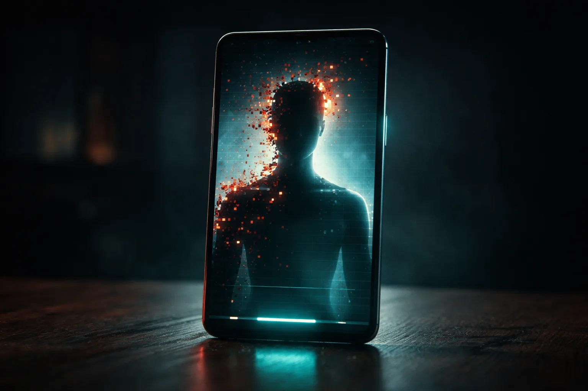

# Prompt de imagem — ia-eleicoes-2026-deepfake

## Metáfora central
Uma urna eletrônica genérica diante de uma tela de celular mostrando uma silhueta de pessoa se fragmentando em pixels vermelhos — o vídeo falso do candidato.

## Prompt de geração (inglês)
A smartphone standing upright on a dark wooden table, its screen showing a video of a blank human silhouette whose edges are breaking apart into floating red and orange pixel fragments, like a digital mask peeling away, soft teal light glowing from the phone's frame and reflecting on the table, faint scan lines across the screen, cinematic lighting, dark background, high detail, 3:2 landscape, no text, no logos

## Alt-text (português)
Celular com silhueta se desfazendo em pixels vermelhos — vídeos falsos com IA nas eleições

## Snippet HTML
```html

```
